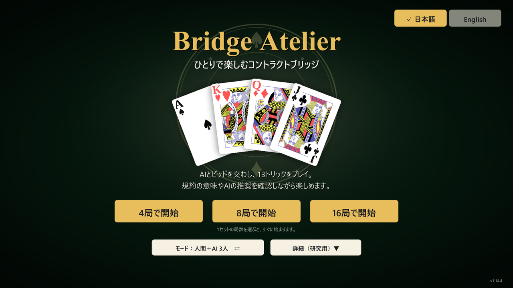
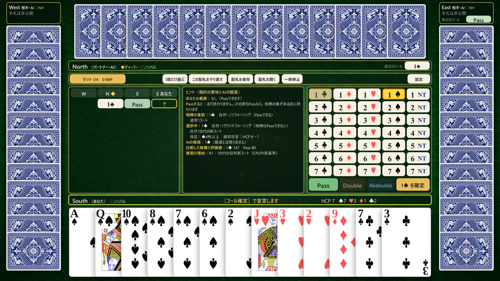
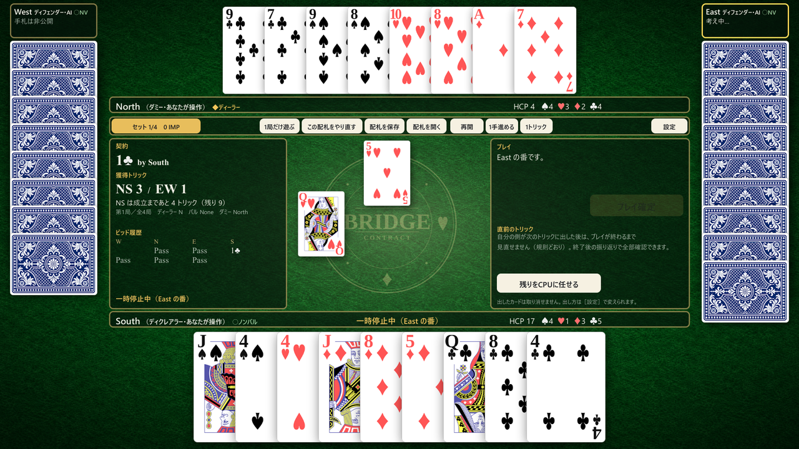
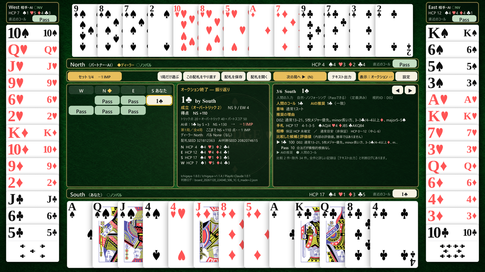

# Bridge Atelier

**ひとりで遊び、判断を振り返るコントラクトブリッジ。**

Bridge Atelierは、ほかの席をAIが担当する、一人用のコントラクトブリッジゲームです。人間がサウスを担当するモードと、AI4人のプレイを観察するモードがあります。オークションからカードプレイ、採点、振り返りまで、4・8・16局のセットを通して楽しめます。

**[Windows版を入手](https://github.com/naoki927higuchi/bridge-atelier/releases/latest) · [ブラウザで遊ぶ](https://af-atelier.itch.io/bridge-atelier) · [はじめに](docs/ja/getting-started.md)**

> Windows版はすべての機能を使えます。Web版はブラウザで遊べ、一部の機能（判断ログの保存、配札のファイルを開くなど）はWindows版だけにあります。

## 特徴

### 市ヶ谷ビディング規約でオークション

ビディングAIは本作独自の **市ヶ谷ビディング規約（Ichigaya Bidding System）** を判断の基礎として使用します。オークション中は、規約上の意味を確認でき、設定によりAIの推奨も表示できます。AIの推奨は最適解を保証するものではありません。

[ビディング規約を読む](docs/ja/bidding-system.md)

### カードをプレイする

カードをプレイして契約の達成、または相手の契約の阻止を目指します。自分がディクレアラーならダミーのカードも自分で選び、ディフェンダーならAIのパートナーと守ります。

### 1局ごとの判断を振り返る

オークションとカードプレイを振り返り、表示されるAIの推奨や判断内容を確認できます。得点にはデュプリケートブリッジの得点表を使用し、人間＋AI3人のセットでは、同じ配札をAI4人でプレイした**AI卓**とのIMP比較も行います。人間同士のデュプリケート競技や順位付けを再現するものではありません。

### SEEDで配札を再現

セットSEEDを指定すると、同じゲームバージョン内で配札を再現できます。同じセットSEEDなら、4・8・16局のどれを選んでも、先頭から共通の配札になります。AIの判断は、人間の操作やカードプレイAIの思考レベルによって変わることがあります。

## 遊び方・資料

- [はじめに](docs/ja/getting-started.md) — 最初のセットを始めるまで
- [操作マニュアル](docs/ja/user-manual.md) — 画面、操作、設定、採点、振り返り
- [市ヶ谷ビディング規約](docs/ja/bidding-system.md) — 取り決めとAIの対応状況
- [用語集](docs/ja/terminology.md) — 用語の定義と対訳
- [English README](README.md)

## フィードバック

質問・感想・提案・不具合の報告は[GitHub Discussions](https://github.com/naoki927higuchi/bridge-atelier/discussions)へお願いします。GitHub Discussionsが唯一の公式の窓口です。回答・調査・修正・要望の採用は保証しません。初回公開の時点ではGitHub Issuesは無効で、Pull Requestsは受け付けません。

## 利用条件とライセンス

- ゲーム本体（Windows版・Web版）は、個人・法人、商用・非商用を問わず無料でプレイできます。プレイ動画やスクリーンショットは事前の許可なく利用できます。再配布などの条件は[利用条件](TERMS.ja.md)を参照してください。ソースコードは公開していません。
- このREADMEと公開ドキュメント（Getting Started、User Manual、Bidding System、Bidding Reference、用語集）は[CC BY 4.0](https://creativecommons.org/licenses/by/4.0/)で提供します。ゲーム本体・ソースコード・第三者の素材は対象外です。
- 本ゲームに含まれる第三者のソフトウェアと素材は、[第三者ライセンス通知](THIRD_PARTY_NOTICES.md)を参照してください。

---

© 2026 AF。この文書は[CC BY 4.0](https://creativecommons.org/licenses/by/4.0/)で提供します。ゲーム本体の利用条件は[利用条件](TERMS.ja.md)を参照してください。
