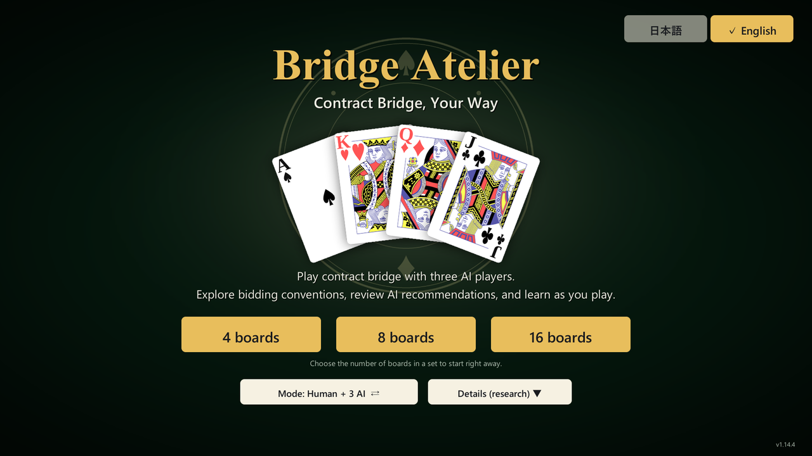
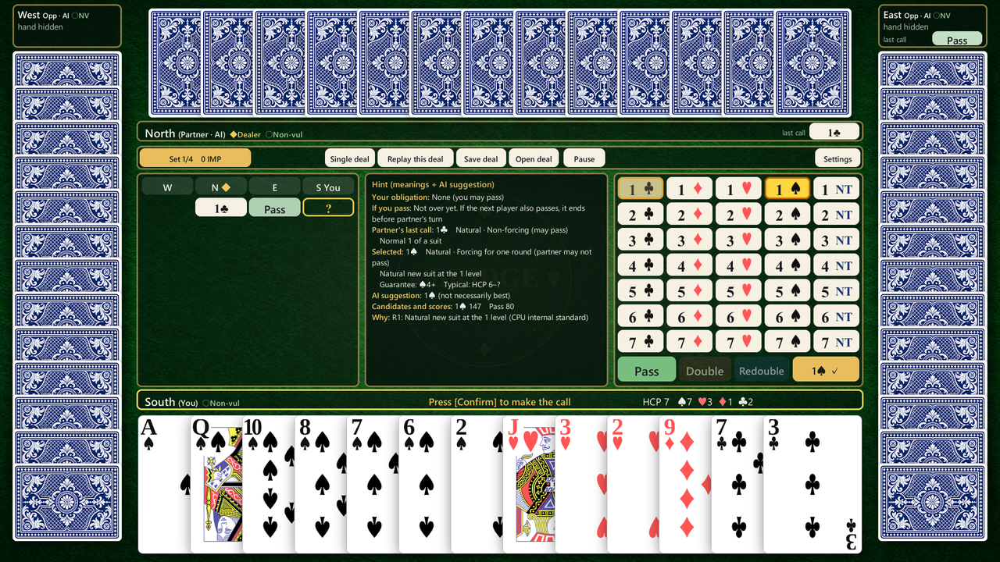
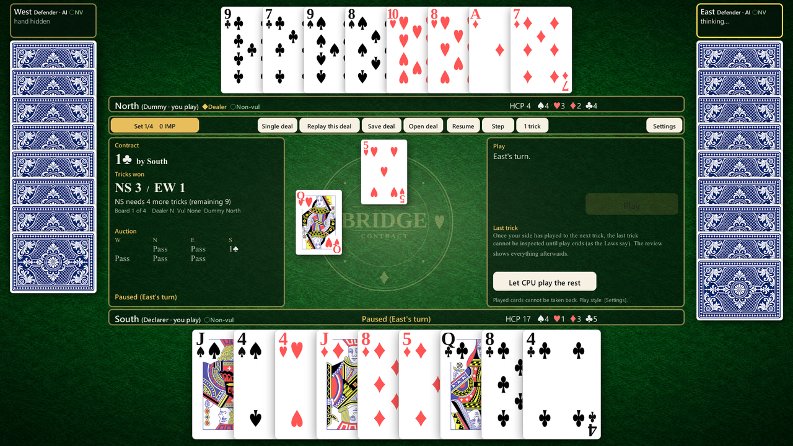
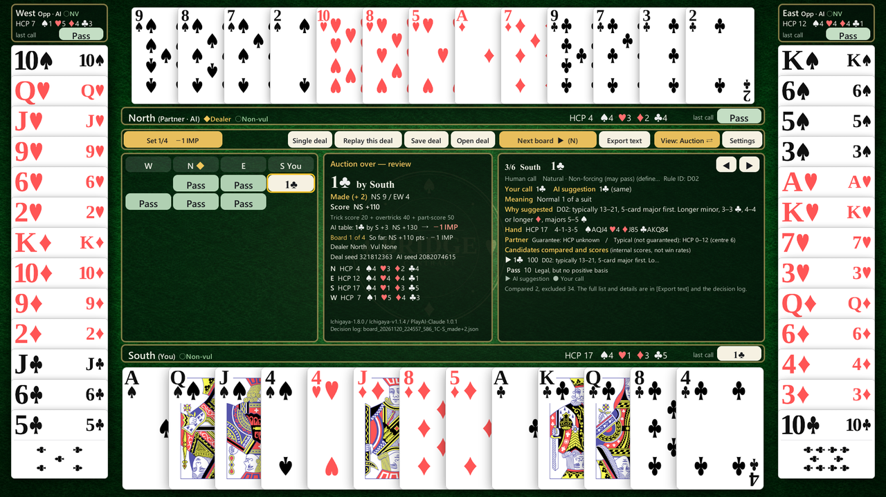

# Bridge Atelier

**Play contract bridge solo—and revisit the decisions behind each hand.**

Bridge Atelier is a single-player contract bridge game in which AI players take the other seats. Play as South or watch four AI players at the table. Bid, play, score, and review sets of 4, 8, or 16 boards.

**[Get the Windows version](https://github.com/naoki927higuchi/bridge-atelier/releases/latest) · [Play in your browser](https://af-atelier.itch.io/bridge-atelier) · [Getting started](docs/en/getting-started.md)**

> The Windows version has every feature. The browser version runs in your browser; a few features, such as saving decision logs and opening deal files, are available only in the Windows version.

## Features

### Bid with the Ichigaya Bidding System

The bidding AI uses the game's **Ichigaya Bidding System** as its framework. During the auction, you can inspect the meanings of calls and optionally display an AI suggestion. Suggestions are guidance, not guaranteed optimal calls.

[Explore the bidding system](docs/en/bidding-system.md)

### Play the cards

Make or defeat contracts through card play. When you are declarer, you also choose the cards played from dummy; when defending, you play your own hand alongside an AI partner.

### Review decisions and results

Review the auction and card play, including available AI suggestions and decision details. The game uses the duplicate bridge scoring table. In human-plus-three-AI sets, it also compares your table with a **four-AI table** playing the same deal, converting the score difference to IMPs. This is not a human duplicate bridge tournament or ranking system.

### Replay deals with seeds

A set seed lets you reproduce deals within the same game version. With the same set seed, sets of 4, 8, and 16 boards share their initial deals. AI decisions can still vary with human actions and the card-play AI thinking level.

## Documentation

- [Getting started](docs/en/getting-started.md) — Play your first set
- [User manual](docs/en/user-manual.md) — Controls, settings, scoring, and review
- [Ichigaya Bidding System](docs/en/bidding-system.md) — Conventions and AI support
- [Terminology](docs/en/terminology.md) — Definitions of the terms used in the game and the documents
- [日本語 README](README.ja.md)

## Feedback and community

Use [GitHub Discussions](https://github.com/naoki927higuchi/bridge-atelier/discussions) for questions, ideas, feedback, and bug reports. GitHub Discussions is the only official place for discussion; replies, investigation, fixes, and adoption of requests are not guaranteed. GitHub Issues are disabled at the initial release, and pull requests are not accepted.

## Terms of use and licenses

- The game (the Windows version and the browser version) is free to play for individuals and organizations, for commercial or non-commercial purposes. Gameplay videos and screenshots may be used without prior permission. For redistribution and other conditions, see the [Terms of Use](TERMS.md). The source code is not published.
- This README and the public documentation (Getting Started, User Manual, Bidding System, Bidding Reference, and Terminology) are licensed under [CC BY 4.0](https://creativecommons.org/licenses/by/4.0/). The game, its source code, and third-party materials are not covered.
- For third-party software and materials included in the game, see the [Third-party notices](THIRD_PARTY_NOTICES.md).

---

© 2026 AF. This document is licensed under [CC BY 4.0](https://creativecommons.org/licenses/by/4.0/). For the terms of use of the game itself, see the [Terms of Use](TERMS.md).
